

<a href="https://shabimughal.dev"><picture><source media="(prefers-color-scheme: dark)" srcset="assets/header-dark.svg"></picture></a>

I build web and mobile platforms, secure core systems and data dashboards. I care about performance, reliability and code that is easy to maintain.

  <a href="https://shabimughal.dev"><picture><source media="(prefers-color-scheme: dark)" srcset="assets/sm-btn-portfolio-dark.svg"></picture></a>&nbsp;
  <a href="https://shabimughal.dev/Shabi-Mughal-Resume.pdf"><picture><source media="(prefers-color-scheme: dark)" srcset="assets/sm-btn-resume-dark.svg"></picture></a>&nbsp;
  <a href="https://www.linkedin.com/in/shabi-mughal"><picture><source media="(prefers-color-scheme: dark)" srcset="assets/sm-btn-linkedin-dark.svg"></picture></a>&nbsp;
  <a href="https://github.com/shabicreations033"><picture><source media="(prefers-color-scheme: dark)" srcset="assets/sm-btn-github-dark.svg"></picture></a>&nbsp;
  <a href="mailto:hi.shabimughal@gmail.com"><picture><source media="(prefers-color-scheme: dark)" srcset="assets/sm-btn-email-dark.svg"></picture></a>&nbsp;
  <a href="https://wa.me/923241771864"><picture><source media="(prefers-color-scheme: dark)" srcset="assets/sm-btn-whatsapp-dark.svg"></picture></a>

<picture><source media="(prefers-color-scheme: dark)" srcset="assets/divider-dark.svg"></picture>

<picture><source media="(prefers-color-scheme: dark)" srcset="assets/t-profile-dark.svg"></picture>

<a href="https://shabimughal.dev"><picture><source media="(prefers-color-scheme: dark)" srcset="assets/profile-dark.svg"></picture></a>

<picture><source media="(prefers-color-scheme: dark)" srcset="assets/divider-dark.svg"></picture>

<a href="https://shabimughal.dev/projects"><picture><source media="(prefers-color-scheme: dark)" srcset="assets/t-projects-dark.svg"></picture></a>

<a href="https://github.com/shabicreations033/TaskPoint-App"><picture><source media="(prefers-color-scheme: dark)" srcset="assets/card-taskpoint-dark.svg">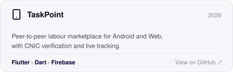</picture></a>
<a href="https://github.com/shabicreations033/AI-Smart-Warehouse-and-Delivery-Management-System"><picture><source media="(prefers-color-scheme: dark)" srcset="assets/card-warehouse-dark.svg">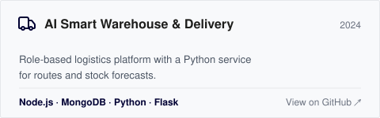</picture></a>
<a href="https://github.com/shabicreations033/Social-media-Analytics-Dashboard"><picture><source media="(prefers-color-scheme: dark)" srcset="assets/card-dashboard-dark.svg">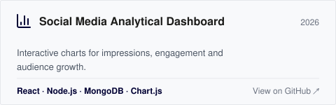</picture></a>
<a href="https://github.com/shabicreations033/Accounting-System"><picture><source media="(prefers-color-scheme: dark)" srcset="assets/card-techfix-dark.svg">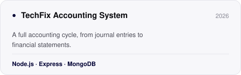</picture></a>
<a href="https://github.com/shabicreations033/SafeState-Multi-Layered-Cryptography"><picture><source media="(prefers-color-scheme: dark)" srcset="assets/card-safestate-dark.svg">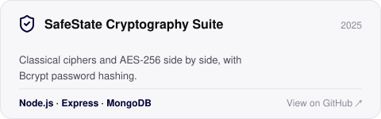</picture></a>
<a href="https://github.com/shabicreations033/Lexical-Analyzer"><picture><source media="(prefers-color-scheme: dark)" srcset="assets/card-fluxlex-dark.svg">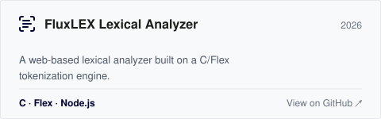</picture></a>
<a href="https://github.com/shabicreations033/Deadlock-Detection"><picture><source media="(prefers-color-scheme: dark)" srcset="assets/card-deadlock-dark.svg">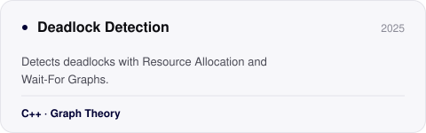</picture></a>
<a href="https://github.com/shabicreations033/Netflix-Data-Analysis"><picture><source media="(prefers-color-scheme: dark)" srcset="assets/card-netflix-dark.svg">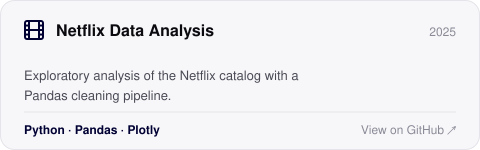</picture></a>

Full write-ups with screenshots are on <a href="https://shabimughal.dev/projects">shabimughal.dev/projects</a>.

<picture><source media="(prefers-color-scheme: dark)" srcset="assets/divider-dark.svg"></picture>

<picture><source media="(prefers-color-scheme: dark)" srcset="assets/t-stack-dark.svg"></picture>

<picture><source media="(prefers-color-scheme: dark)" srcset="assets/tech-dark.svg">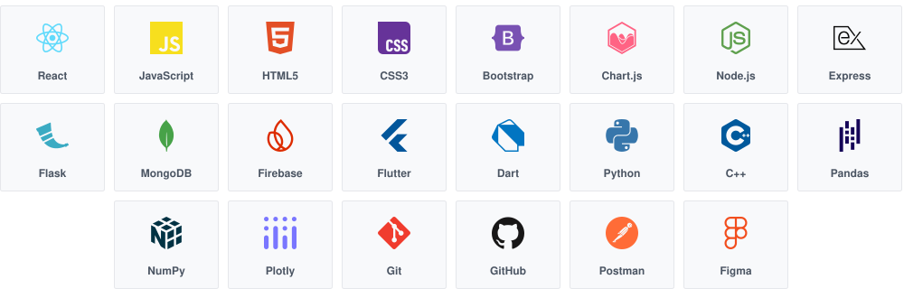</picture>

<picture><source media="(prefers-color-scheme: dark)" srcset="assets/divider-dark.svg"></picture>

<a href="https://shabimughal.dev"><picture><source media="(prefers-color-scheme: dark)" srcset="assets/t-credentials-dark.svg"></picture></a>

<a href="https://shabimughal.dev"><picture><source media="(prefers-color-scheme: dark)" srcset="assets/cert-1-dark.svg">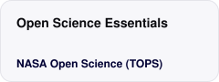</picture></a>
<a href="https://shabimughal.dev"><picture><source media="(prefers-color-scheme: dark)" srcset="assets/cert-2-dark.svg">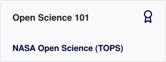</picture></a>
<a href="https://shabimughal.dev"><picture><source media="(prefers-color-scheme: dark)" srcset="assets/cert-3-dark.svg">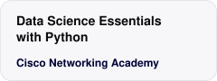</picture></a>
<a href="https://shabimughal.dev"><picture><source media="(prefers-color-scheme: dark)" srcset="assets/cert-4-dark.svg"></picture></a>
<a href="https://shabimughal.dev"><picture><source media="(prefers-color-scheme: dark)" srcset="assets/cert-5-dark.svg"></picture></a>
<a href="https://shabimughal.dev"><picture><source media="(prefers-color-scheme: dark)" srcset="assets/cert-6-dark.svg"></picture></a>
<a href="https://shabimughal.dev"><picture><source media="(prefers-color-scheme: dark)" srcset="assets/cert-7-dark.svg">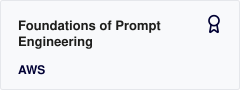</picture></a>
<a href="https://shabimughal.dev"><picture><source media="(prefers-color-scheme: dark)" srcset="assets/cert-8-dark.svg">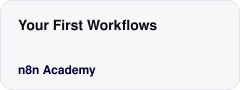</picture></a>

<picture><source media="(prefers-color-scheme: dark)" srcset="assets/divider-dark.svg"></picture>

<a href="mailto:hi.shabimughal@gmail.com"><picture><source media="(prefers-color-scheme: dark)" srcset="assets/footer-dark.svg">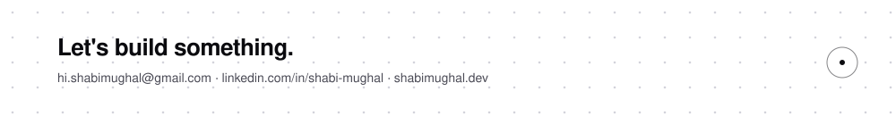</picture></a>

